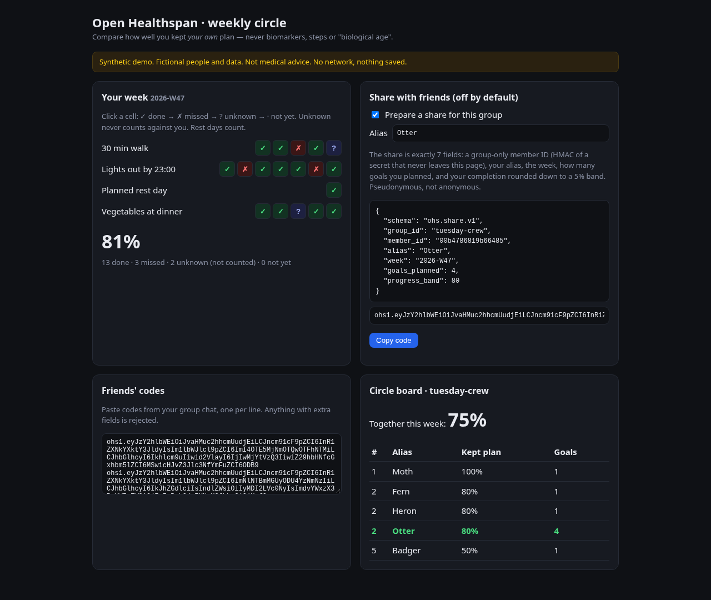

# Open Healthspan

A friendly, open-source longevity leaderboard you can share with friends **without sharing your health data**.

Inspired by the Rejuvenation Olympics, the [Longevity World Cup](https://github.com/nopara73/LongevityWorldCup) and Bryan Johnson's Blueprint. One deliberate difference: you don't compete on biomarkers, steps or "biological age". Each person picks their own weekly plan, and the board compares **how well each of you kept your own plan**.



## How the obfuscated score works

1. **Plan.** Each ISO week you choose 1–7 goals (planned rest counts). Each chance to do a goal is marked `done`, `missed` or `unknown`. `unknown` never counts for or against you, and there are no wearables or lab tests to buy.
2. **Score locally.** Completion is `done / (done + missed)`, capped at 100%. It is computed on your device, and day-level data never leaves it.
3. **Share, only if you opt in, and only once the week is finished.** The share is exactly 7 fields:

   | field | why it is safe to share |
   |---|---|
   | `schema` | version tag |
   | `group_id` | which friend circle this is for |
   | `member_id` | `HMAC-SHA256(device secret, group_id)`, cut to 16 hex chars: stable inside one group, unlinkable across groups |
   | `alias` | whatever name you choose |
   | `week` | ISO week only, no timestamps |
   | `goals_planned` | 1–7 |
   | `progress_band` | completion **rounded down to a 5% band** |

   It travels as one paste-able code (`ohs1.…`) through any chat app. There is no server.
4. **Board.** Friends paste codes into the board. Anything with extra fields is rejected. Groups and weeks never mix, a member's later entry replaces their earlier one, ties share a rank, and the group's *together* score comes first.

**Honest limits:** this is pseudonymous, not anonymous. Your friends know who "Otter" is. The share code is encoded, not encrypted. See [RFC 0003](docs/rfcs/rfc-0003-consent.md).

## Run it

The pretotype site (`site/`, see [docs/pretotype.md](docs/pretotype.md)) runs the same scoring code with a few "tell us you want it" buttons for features that aren't built yet.

```sh
npm test         # 19 unit tests (node:test, zero dependencies)
npm run check    # privacy gate: no network/storage APIs in src/ or demo/, no deps
npm run demo     # site http://127.0.0.1:4173/site/ · demo /demo/ (loopback only, CSP connect-src 'none')
python3 scripts/e2e.py http://127.0.0.1:4173/demo/   # headless Chromium e2e (needs `pip install playwright`)
```

The demo uses **synthetic, fictional data only**.

## Scope and design

The design is in six RFCs: [scope](docs/rfcs/rfc-0001-scope.md), [fair leaderboards](docs/rfcs/rfc-0002-leaderboards.md), [consent & threat model](docs/rfcs/rfc-0003-consent.md), [device-neutral adapters](docs/rfcs/rfc-0004-interoperability.md) and [outcome study](docs/rfcs/rfc-0005-study.md), plus [a research path](docs/rfcs/rfc-0006-research-access.md) that doesn't wait on a hospital data pull.

The non-goals are firm:
- no diagnosis or treatment, and no claims of life extension;
- no global identity, and no raw HRV, GPS or lab values in any share;
- no streak shame, and no scores above 100;
- nothing that requires money or a wearable.

Planned later, all optional: importers for Apple Health, Health Connect and NOOP export via [Open Wearables](https://github.com/the-momentum/open-wearables) and [Open mHealth](https://github.com/openmhealth/schemas) (RFC 0004), and research opt-in modeled on [Open Humans](https://www.openhumans.org/) (RFC 0005). Both stay separate from social sharing.

This project lives outside [NOOP](https://github.com/ryanbr/noop) on purpose. NOOP is offline-first and PolyForm Noncommercial, and it excludes hosted social features.

## Credits

Competition design is inspired by the Longevity World Cup (MIT), Rejuvenation Olympics and RUNSTR. No external code is copied.

## License

MIT
